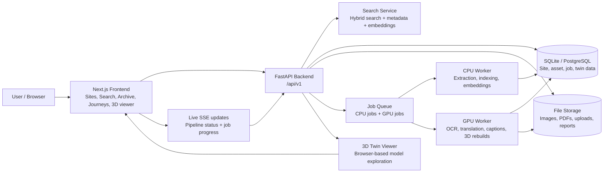

# Virasat3D

Virasat3D is a heritage discovery and preservation platform for Indian cultural and architectural sites. It combines a searchable archive, interactive atlas, geotagged photo collections, and immersive 3D digital twins so people can explore heritage through stories, maps, and spatial reconstruction.

# 🎬 [▶ WATCH DEMO VIDEO](https://drive.google.com/file/d/1q8FazwDBSN-CmsolxroiC6NowPGshWGT/view?usp=sharing)

## Overview

The project helps surface heritage knowledge that is often scattered across field notes, PDFs, notebooks, photos, and local records. Virasat3D brings those materials together into a single experience where users can:

- Browse heritage sites and crafts
- Search across regional languages and scripts
- Inspect archival content with translations and context
- Explore journeys and story-led heritage narratives
- Open site-specific 3D reconstructions in-browser


## Key features

- Heritage site catalog with filters by region and category
- Cross-script and multilingual search experience
- Archive and document viewer for uploaded heritage material
- Journey/story pages that present heritage narratives over time
- 3D twin support for selected monuments and sites
- Local crafts and heritage stay discovery
- FastAPI backend with typed API contracts and live job updates
- Next.js frontend with map-first browsing and responsive UI

## Tech stack

- Frontend: Next.js, TypeScript, Tailwind CSS, MapLibre, TanStack Query
- Backend: FastAPI, SQLAlchemy, SQLite/PostgreSQL-ready app configuration
- Data processing: OCR, translation, indexing, metadata extraction, hybrid search
- 3D: Digital reconstruction workflows for supported heritage sites

## Repository structure

```text
HeritageLens/
├── backend/              FastAPI API and business logic
│   ├── app/
│   ├── migrations/
│   ├── tests/
│   └── var/
├── frontend/             Next.js app
│   ├── src/
│   ├── public/
│   └── package.json
├── ml/                   GPU worker utilities and model-related tooling
├── notebooks/            notebook workflows
├── docs/                 screenshots and documentation assets
├── deploy/               deployment config and smoke checks
├── README.md             project overview
├── PROJECT_STATUS.md     internal project status notes
├── render.yaml            Render deployment config
└── .gitignore
```

## Getting started

### 1. Backend

```bash
cd backend
python -m venv .venv
# Windows: .venv\Scripts\activate
# macOS/Linux: source .venv/bin/activate
pip install -e ".[ml,dev]"
python -m app.cli migrate
python -m app.cli seed
python -m app.cli serve
```

The backend runs at `http://127.0.0.1:8000` and exposes docs at `/docs`.

### 2. Frontend

```bash
cd frontend
npm install
npm run dev
```

The web app runs at `http://localhost:3000` and proxies API requests as configured in the frontend environment.

## Environment configuration

- Backend settings use the `HL_` prefix.
- Frontend settings are defined in `frontend/.env.example`.
- The app expects the API to be available before most frontend flows are used.

## Project goals

Virasat3D is designed to make heritage more accessible, searchable, and immersive for both public audiences and research workflows. It focuses on preserving cultural memory while making historical information easier to discover and understand.

## Development notes

- The backend is organized around API routes, domain services, storage, and database models.
- The frontend uses a map-first and story-first user experience.
- Public site data and archive content are kept filtered and curated based on active project needs.

## Deployment

This repository includes deployment-related files for hosting and smoke testing. Check the deploy configuration in `render.yaml` and the helper scripts under `deploy/` for production setup guidance.

## Live links

- Web app: [Add live URL]
- API docs: [Add live API URL]

## System architecture



This architecture keeps the product experience in the frontend while the backend handles indexing, search, job execution, and heritage data processing. Public-facing browsing is powered by the frontend, while CPU and GPU workers process uploads and enrichments asynchronously behind the API.

## License

This project is built for heritage preservation and public cultural access. Please check the repository files for the current licensing and attribution details before reuse or redistribution.
